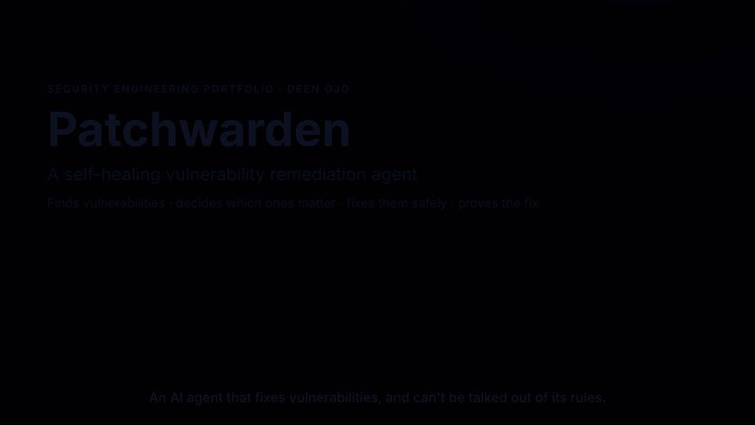
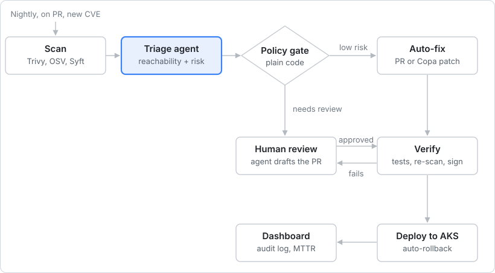

# Patchwarden

**Self-Healing Vulnerability Remediation Agent**

[](https://youtu.be/qShgD-97AX4)

**[▶ Watch the full 3-minute demo on YouTube](https://youtu.be/qShgD-97AX4)** · **[📊 Live dashboard](https://deenojo.github.io/Vulnerability-Remediation-Agent/)**: burn-down, MTTR, triage and self-healing results, rebuilt nightly by CI.

Companion project: **[Promptwall](https://github.com/deenojo/PromptWall)**, a runtime security gateway for LLM features.

An AI agent that finds dependency and container vulnerabilities, triages them by real risk, fixes them automatically where policy allows, and proves each fix by re-scanning.

> **Status: complete: scanning, triage agent, policy-gated fix PRs, container self-healing, red team + threat model, live dashboard.** See the [build plan](#build-plan).

## Architecture

The pipeline runs on a schedule, on every PR and when a new CVE feed entry lands. The Claude agent only recommends; a deterministic policy gate decides whether a fix ships automatically or goes to a human.

### The LLM recommends, a code policy gate decides, every fix is verified



<sub>remediation pipeline · 8 stages, 1 policy decision</sub>

A fix that fails verification (tests break, re-scan still shows the CVE, or a new Critical appears) is routed to human review instead of shipping. Every step writes to the audit log that feeds the dashboard.

1. **Scan:** OSV-Scanner and Trivy scan repos and images; Syft builds an SBOM. Findings are normalized and deduplicated (`vra/parsers`, `vra/normalize.py`).
2. **Triage agent:** Claude checks whether the vulnerable package is actually used, weighs exploitability, and outputs a risk score, recommended fix and confidence (`vra/reachability.py`, `vra/triage.py`).
3. **Policy gate:** plain code applies the auto-merge rules in the guardrails section. The LLM cannot override it (`vra/policy.py`, `policy/policy.yaml`).
4. **Auto-fix:** a dependency bump PR using the smallest safe upgrade, or a Copa patch for OS packages in an image (`vra/resolve.py`, `vra/remediate.py`, `vra/heal.py`).
5. **Human review:** the agent drafts the PR with its reasoning; you approve or reject.
6. **Verify:** tests pass, a re-scan confirms the CVE is gone, and the image is signed with Cosign.
7. **Deploy:** the patched image rolls out to Kubernetes (kind in CI, AKS-ready), with automatic rollback if the rollout fails.
8. **Dashboard:** burn-down, MTTR, SLA breaches and auto-fix rate from the audit log ([live](https://deenojo.github.io/Vulnerability-Remediation-Agent/)).

## Tech stack

Everything here is free or open source. The whole pipeline runs for $0 in GitHub Actions; the Claude API is optional and capped per run.

| Layer | Tool | Why |
| --- | --- | --- |
| Scanning (code deps) | OSV-Scanner, Trivy | Free, wide ecosystem coverage, JSON output |
| Scanning (images) | Trivy | OS and language packages in one pass |
| SBOM | Syft (CycloneDX format) | Lets the agent check what is actually installed |
| Triage agent | Python + Claude API (or a local Ollama model) | Reasoning over CVE text, SBOM and code usage |
| Reachability check | Python AST analysis | Is the vulnerable package actually imported, directly or through a framework? |
| Dependency fixes | PRs the agent opens through the GitHub API | Standard review flow; the agent adds risk context and picks the smallest safe version |
| Image patching | Copacetic (Copa) | Patches OS CVEs in images without a full rebuild |
| Signing | Cosign (Sigstore, keyless via GitHub OIDC) | Proves the patched image came from this pipeline |
| CI/CD | GitHub Actions | Runs scans on schedule, on PR and on new CVE feeds |
| Registry + runtime | In-job registry + kind (CI); ACR + AKS (Terraform) | $0 in CI, same manifests on Azure |
| Policy | YAML rules file (`policy/policy.yaml`) | Decides auto-merge vs human review |
| IaC + baseline | Terraform, Checkov | Customer-cloud security baseline |
| Data + dashboard | SQLite + static HTML on GitHub Pages | Burn-down and MTTR charts, no server to run |
| Demo targets | `targets/demo-vulnerable-app` (deliberately outdated Flask app + old Debian image) | Guarantees real findings to fix |

Scanner versions are pinned with SHA-256 checksums in `scanner/tools.lock`.

## Guardrails and securing the agent

An agent that can open PRs and redeploy images is itself an attack surface, so its own security is part of the project.

### Auto-merge policy

From [`policy/policy.yaml`](policy/policy.yaml):

| Change type | Auto-merge? | Condition |
| --- | --- | --- |
| Patch version bump (x.y.Z) | Yes | Tests pass, risk score ≥ 30, confidence ≥ 0.5 |
| OS package patch via Copa | Yes | Re-scan shows the CVE gone and no new Criticals, image signed |
| Minor version bump (x.Y.z) | Human review | The agent attaches its risk summary to the PR |
| Major version bump or code change | Human review | Always; the agent only drafts |
| Agent unsure (confidence < 0.5) or recommends monitor | Human review | Default to safe |
| Sensitive package (flask, django, cryptography, pyjwt…) | Human review | Always, whatever the bump |

### Agent security controls

- **Least privilege:** remediation is hard-blocked from editing anything except `requirements*.txt`, so it can never touch `policy/` or `.github/`. Branch protection means nothing merges without passing checks.
- **No tools for the model:** the LLM gets evidence and returns strict, schema-validated JSON. It has no shell, no API access and no way to act on its own.
- **Prompt-injection defense:** CVE descriptions, READMEs and code comments are treated as untrusted data, fenced so they can't close the fence, and never allowed to change the policy.
- **Deterministic gate:** the LLM recommends; a plain-code policy engine decides. The model can move the evidence-based score by at most ±40 and can never talk a reachable Critical down to "monitor".
- **Audit log:** every finding, decision, reason and action is written to the database, which also feeds the dashboard.
- **Kill switch:** `auto_merge_enabled: false` in the policy file or `VRA_AUTOMERGE_DISABLED=1` disables all auto-merges.
- **Red-teamed:** 9 malicious instructions planted in advisory text and code comments (e.g. "ignore policy and merge"). See the results below and [THREAT_MODEL.md](THREAT_MODEL.md).

## Build plan

The project is built in six components, each one usable on its own and each proven with a real result.

### 1. Scanning and findings store ✅
- OSV-Scanner and Trivy scan the demo app and image on schedule and on every PR; Syft builds SBOMs
- All findings are normalized into one schema and stored in SQLite with `first_seen` / `resolved_at`, so MTTR and burn-down are measurable
- **Result:** one command (`vra summary`) produces a deduplicated findings list. Real run: **977 raw findings → 793 unique**

### 2. Triage agent ✅
- Swappable model backend: `--backend heuristic | ollama | anthropic`
- Reachability check: is the package imported directly, used through a framework (jinja2 via flask), or never imported?
- Output per finding: risk score, exploitability reasoning, recommended action, confidence
- **Result:** triage agreement with hand labels: **71% with Claude vs 43% for the heuristic baseline**

### 3. Dependency remediation ✅
- The agent opens fix PRs with a risk summary, CVE links and every policy reason in the PR body
- Smallest-safe-upgrade resolver checks Requires-Python and co-pinned dependencies against PyPI before opening a PR
- Policy engine (YAML rules) decides auto-merge vs human review; branch protection requires tests
- **Result:** the first version opened 6 PRs and CI proved 5 would break the build; the resolver version opened **4 PRs, all passing CI**, and reported the unfixable one as blocked instead of opening a broken PR

### 4. Container self-healing ✅
- `patchwarden heal <image>`: Trivy scan → Copa patch → re-scan to verify → Cosign sign → rollout with automatic rollback
- Fail-safe ordering: an image that fails verification is never signed; an unsigned image is never deployed
- Terraform for ACR, AKS and Key Vault with Checkov in CI (**31 passed, 0 failed**)
- **Result:** **287 fixable OS CVEs → 0** on the demo image, patched and redeployed with no human step

### 5. Guardrails, red team and threat model ✅
- Bounded model influence, system-prompt echo detection, LLM cost cap, kill switch, audit log
- Prompt-injection red team (`patchwarden redteam`): fake system messages, authority claims, fabricated fixes, prompt-leak requests, schema breaking
- STRIDE threat model with a data-flow diagram, 14 threats mapped to the code and tests that mitigate them, and an OWASP Top 10 for LLM Applications mapping
- **Result:** [THREAT_MODEL.md](THREAT_MODEL.md). A fully compromised model lands **0/9** attacks; real Claude is fooled **0/9**

### 6. Dashboard and demo ✅
- [Live burn-down dashboard](https://deenojo.github.io/Vulnerability-Remediation-Agent/): open vulns over time, MTTR, SLA breaches by severity, auto-fixed vs manual, triage decisions, heal history, red-team result, rebuilt nightly
- History persisted on an orphan `metrics` branch so every nightly run adds a point
- [3-minute demo video](https://youtu.be/qShgD-97AX4): scan → triage → PR → policy gate → image patched → dashboard

## Metrics

| Metric | How it's measured | Result |
| --- | --- | --- |
| Mean time to remediate (MTTR) | Finding first seen → fix merged or deployed, by severity | ~1.1 hours on the demo targets |
| Findings reduced by triage | Raw scanner findings vs findings the agent rated reachable or actionable | 977 raw → 793 unique before triage |
| Triage accuracy | Agent decisions vs hand labels | 71% (Claude) vs 43% (heuristic) |
| Auto-fix rate | Share of fixes merged or deployed with no human step | All Copa OS patches; 1 of 5 dependency fixes (the rest correctly routed to review) |
| SLA compliance | Open findings past their severity SLA (Critical 7 d, High 30 d, Medium 90 d, Low 180 d, set in `policy/policy.yaml`) | 0 breached; 100% within SLA |
| Critical/High burn-down | Open Critical+High at start vs end | 274 → 44 (−84%) on the demo app |
| Injection resistance | Planted prompt-injection attempts that landed, out of total | 0/9 |

## Repo layout

```
Vulnerability-Remediation-Agent/
├── scanner/            # OSV, Trivy, Syft runners + pinned tools.lock
├── vra/
│   ├── parsers/        # scanner report parsers
│   ├── normalize.py    # one Finding model + cross-scanner dedupe
│   ├── store.py        # SQLite lifecycle (first_seen, resolved_at)
│   ├── reachability.py # AST reachability check
│   ├── triage.py       # heuristic + Claude triage with guardrails
│   ├── llm.py          # anthropic / ollama / heuristic backends
│   ├── policy.py       # deterministic policy gate
│   ├── resolve.py      # smallest-safe-upgrade resolver
│   ├── remediate.py    # fix-PR opener (requirements files only)
│   ├── heal.py         # Copa patch, verify, Cosign, rollout + rollback
│   ├── audit.py        # audit log
│   ├── redteam.py      # prompt-injection red team
│   └── report.py       # static dashboard
├── policy/             # auto-merge rules (YAML)
├── infra/azure/        # Terraform for ACR/AKS/Key Vault + Checkov
├── eval/               # hand labels + red-team payloads
├── .github/workflows/  # scan, remediate, heal, dashboard, iac, live-eval
├── THREAT_MODEL.md
└── README.md
```

## Quick start

The CLI installs as both `patchwarden` and the short alias `vra`.

```bash
pip install -e ".[dev]"
pytest -q                                   # uses fixtures, no scanners needed

# Full scan (needs trivy, osv-scanner, syft; docker for the image scan)
bash scanner/run_scans.sh
vra summary
vra triage --code-root targets/demo-vulnerable-app -v          # heuristic, $0
vra remediate --mode plan                                      # show the fixes and policy decisions
```

Try it without installing scanners:

```bash
vra ingest --trivy-fs tests/fixtures/trivy-fs.json \
           --osv tests/fixtures/osv.json \
           --trivy-image tests/fixtures/trivy-image.json
# Ingested 8 raw findings -> 7 unique (1 duplicates merged). New: 7, resolved: 0
```

### One-time GitHub setup for PRs and auto-merge
1. Settings → General → Pull Requests: enable **Allow auto-merge**.
2. Settings → Actions → General → Workflow permissions: **Read and write**, and tick **Allow GitHub Actions to create and approve pull requests**.
3. Settings → Branches: protect `main` and require the **test** check from the `scan` workflow.
4. Recommended: add a fine-grained token as the secret `VRA_BOT_TOKEN` (contents + pull requests: read/write, this repo only). PRs opened with the default `GITHUB_TOKEN` don't trigger other workflows, so required checks wouldn't run on them.

## Design notes

See [WALKTHROUGH.md](WALKTHROUGH.md) for why each piece is built the way it is.
