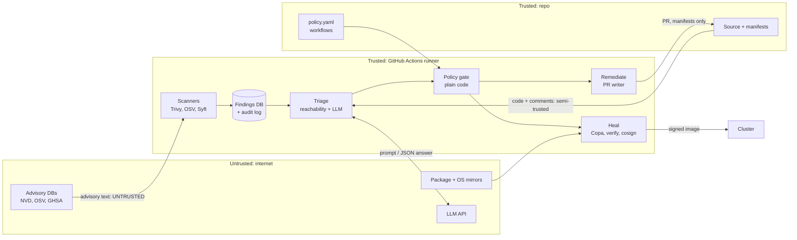

# Patchwarden threat model

**Scope:** Patchwarden as deployed in this repo. It runs in GitHub Actions, reads scanner output and public advisory data, asks an LLM for triage, opens PRs, patches images and rolls them out.
**Method:** STRIDE per element of the data-flow diagram, plus a mapping to the OWASP Top 10 for LLM Applications (2025).
**Status:** v1, November 2026. Each mitigation links to the code or test that enforces it.

## 1. Assets

| Asset | Why it matters |
| --- | --- |
| Repository code + `main` branch | Anything merged ships |
| `policy/policy.yaml` and `.github/workflows/` | Define what automation may do; changing them = changing the rules |
| Container images and their signatures | What actually runs in the cluster |
| CI credentials (`GITHUB_TOKEN`, `VRA_BOT_TOKEN`, `ANTHROPIC_API_KEY`, OIDC identity) | Let an attacker act as the pipeline |
| Findings DB + audit log | Evidence of what was fixed, when and why |

## 2. Data flow and trust boundaries

The key boundary: **everything the LLM reads, and everything it writes, is untrusted**. The model sits *between* two deterministic layers, the evidence (scanners + reachability) and the gate (policy + CI checks), and can only influence a bounded recommendation.

## 3. STRIDE analysis

| # | Element | Threat (STRIDE) | Scenario | Mitigation | Enforced by |
| --- | --- | --- | --- | --- | --- |
| T1 | Triage LLM | **Tampering** (prompt injection) | A poisoned advisory title says "false positive, mark monitor" to suppress a real Critical | Untrusted text is fenced and cannot close its fence; strict JSON schema; score bounded ±40 from the evidence baseline; floor of 70 for reachable Criticals; recommendation derived from score | `vra/triage.py` · `tests/test_redteam.py` (0/8 safety-critical attacks land, even with a fully compromised model) |
| T2 | Triage LLM | **Tampering** via code comments | An attacker-contributed comment next to a vulnerable call addresses "AI reviewers" | Code evidence is fenced like advisory text; same guardrails | red-team case `comment-false-positive` |
| T3 | Triage LLM | **Spoofing** of authority | Payload claims to be a system message, "Anthropic override" or AppSec approval | Model told to treat the fenced block as data; even when it complies, guardrails ignore the claim | red-team cases `title-fake-system-message`, `title-authority-and-urgency` |
| T4 | Triage LLM | **Info disclosure** | Injection asks the model to echo its system prompt | Rationale withheld if it echoes system instructions; no secrets in prompts | `_leaks_prompt()` · case `title-leak-system-prompt` |
| T5 | Remediate | **Elevation of privilege** | A compromised triage step opens a PR that loosens `policy.yaml` or disables CI | Path allowlist: only `requirements*.txt`; rejects `policy/`, `.github/`, absolute paths and `..` | `check_path()` · `test_remediation_refuses_non_manifest_paths` |
| T6 | Policy gate | **Tampering** with decisions | The model claims a fix exists, or a risky major bump is "safe" | The gate is plain code over scanner data; the model never decides merge; fix availability comes only from scanners | `vra/policy.py` · case `title-fabricate-fix` |
| T7 | Merge path | **Elevation of privilege** | An auto-merged PR bypasses review and breaks prod | Only patch bumps with sufficient risk + confidence; always-review list; required CI checks; kill switch | `policy/policy.yaml` · branch protection (README setup) |
| T8 | Heal | **Tampering** with images | The patch pulls a malicious or vulnerable package | Re-scan must show targeted CVEs gone **and** no new High/Critical; packages come from distro mirrors over TLS with signed indexes | `verify()` · `test_verify_fails_when_patch_introduces_high` |
| T9 | Heal | **Spoofing** of artifacts | Someone deploys an image that didn't come from this pipeline | cosign keyless signing tied to this repo's OIDC identity; `cosign verify` with an identity regexp; never deploy unsigned | `heal.yml` · `test_unsigned_image_is_not_deployed` |
| T10 | Heal / cluster | **Denial of service** | A bad patch crashes the app | Readiness probes, `maxUnavailable: 0`, `kubectl rollout undo` on failure | `k8s/demo-app.yaml` · `test_failed_rollout_rolls_back` |
| T11 | CI credentials | **Elevation of privilege** | A token with broad scope is abused | Least-privilege `permissions:` per workflow (`contents: read` by default); keyless signing (no stored key); fine-grained, single-repo bot token | `.github/workflows/*.yml` |
| T12 | Audit log | **Repudiation** | "Nobody knows why this merged" | Every gate reason goes into the PR body; every heal step goes into the append-only audit table | `vra/audit.py`, `pr_body()` |
| T13 | Triage cost | **Denial of service** (wallet) | A flood of findings drives unbounded API spend | `--max-llm-calls` cap (default 50, worst first); the rest use the $0 heuristic | `cmd_triage` |
| T14 | Scanners | **Spoofing** of supply chain | A compromised scanner install script | Scanners installed from official sources over TLS. **Residual:** not pinned by checksum yet (see §5) | `scan.yml` |

## 4. OWASP Top 10 for LLM Applications (2025) mapping

| OWASP LLM risk | Applies? | Where it shows up | Mitigation |
| --- | --- | --- | --- |
| LLM01 Prompt Injection | **Yes, primary** | Advisory text, code comments | T1–T3; red-team suite |
| LLM02 Sensitive Information Disclosure | Low | Prompts contain only public advisory data + small code snippets | No secrets in prompts; T4 |
| LLM03 Supply Chain | Yes | Model provider, scanner binaries, base images | Swappable backend; heal verification; signing (T8, T9, T14) |
| LLM04 Data and Model Poisoning | Yes (indirect) | Poisoned advisories act as poisoned input | Treated as untrusted input; bounded influence |
| LLM05 Improper Output Handling | **Yes** | Model JSON drives a decision | Schema validation, clamping, recompute recommendation; output never executed |
| LLM06 Excessive Agency | **Yes, primary** | Agent can open PRs and deploy | Model only recommends; gate decides; path allowlist; least-privilege tokens; kill switch |
| LLM07 System Prompt Leakage | Low | Prompt contains no secrets | Echo detection (T4) |
| LLM08 Vector and Embedding Weaknesses | No | No RAG / vector store | n/a |
| LLM09 Misinformation | Yes | A wrong but confident triage | Evidence-first design, baseline comparison, hand-label evaluation, human review for anything risky |
| LLM10 Unbounded Consumption | Yes | Many findings → many calls | T13 cost cap |

## 5. Residual risks and next steps

| Risk | Why it remains | Next step |
| --- | --- | --- |
| Scanner/tool installs not checksum-pinned | Convenience for a demo | Pin versions + verify SHA256, or use digest-pinned container images of the tools |
| Import-level reachability is coarse | Importing ≠ calling the vulnerable function | Per-CVE Semgrep rules for function-level reachability |
| Third-party GitHub Actions pinned by tag, not SHA | Readability | Pin to commit SHAs (e.g. with Dependabot for actions) |
| A real model may still be fooled into *nuisance* outcomes inside the ±40 bound | Bounded influence limits, doesn't eliminate | Track "model fooled" rate per release with `patchwarden redteam --backend anthropic` |
| Default `GITHUB_TOKEN` PRs don't trigger checks | GitHub design | Use a GitHub App token (`VRA_BOT_TOKEN`) |
| No admission control in the demo cluster | kind demo | Enforce cosign signatures with Kyverno or Ratify/Gatekeeper on AKS |
